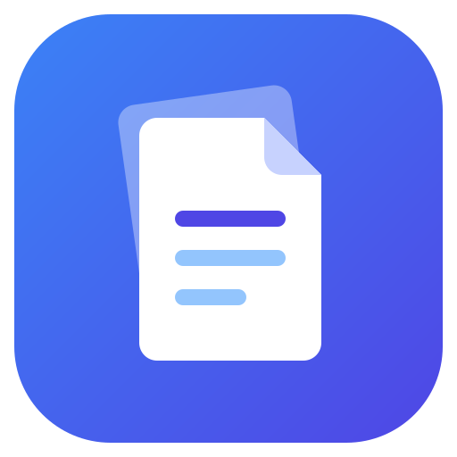
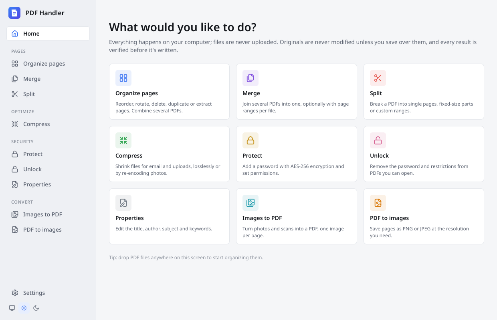
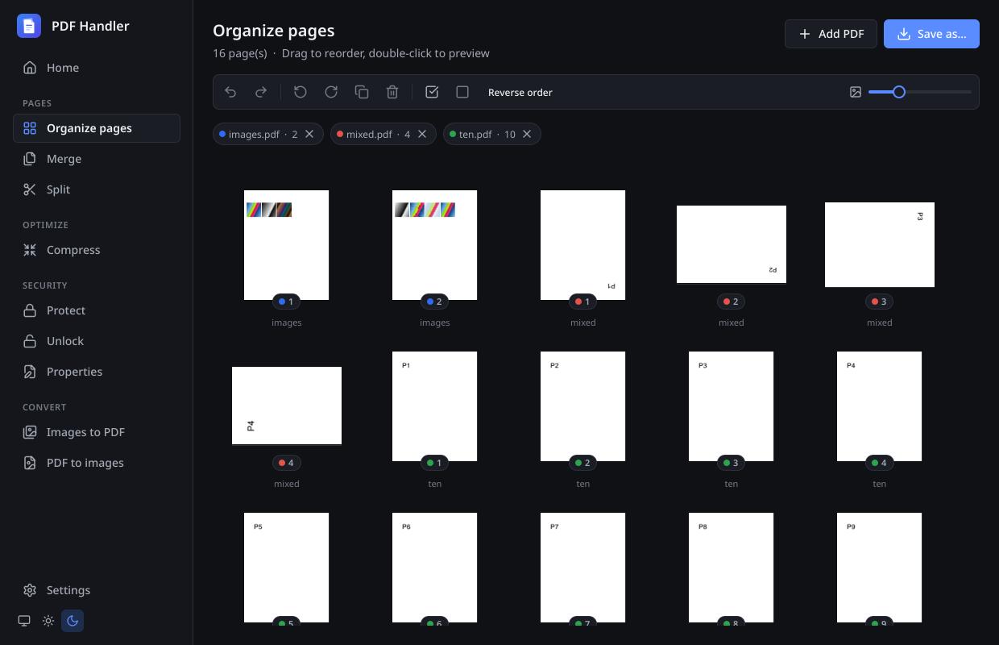
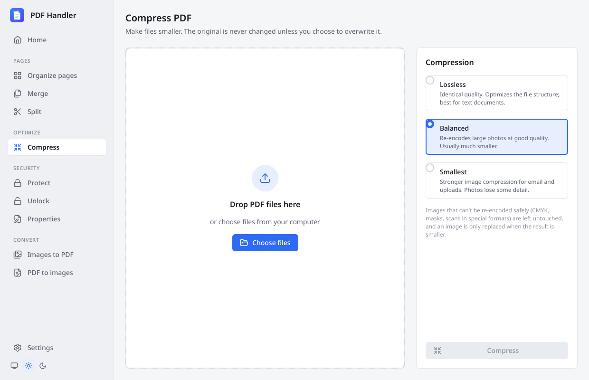

<div align="center">



# PDF Handler

**A fast, private PDF toolkit for Windows, macOS and Linux.**
Organize, merge, split, compress, protect and convert PDFs. Everything runs locally, and your originals are never at risk.

[](https://github.com/arsalan9702/pdf-handler/actions/workflows/ci.yml)
[](https://github.com/arsalan9702/pdf-handler/actions/workflows/package.yml)




</div>

---

## Why PDF Handler

- **Private.** No uploads, no accounts, no network access. Files never leave your computer.
- **Safe.** Every output is verified before it's written, and a failed or cancelled job never touches your existing files. [How that works ↓](#how-your-files-stay-safe)
- **Forgiving.** Broken PDFs are repaired where possible, and the app tells you what it fixed.
- **Fast.** Even very large documents scroll smoothly, and heavy work runs in the background with a progress bar and Cancel.
- **Everywhere.** It's a normal desktop app with launcher and Start menu entries, appears in "Open with" for PDFs, and accepts drag-and-drop. A command-line tool comes with it.

## Features

| Tool | What it does |
|---|---|
| **Organize pages** | Thumbnail grid of every page. Drag to reorder; rotate, delete, duplicate or reverse; undo/redo for everything. Combine several PDFs, or save just the selected pages as a new file. |
| **Merge** | Join PDFs in any order, with an optional page range per file (`1-3, 7, 10-`) and an optional bookmark at the start of each file. |
| **Split** | One file per page, every *N* pages, or custom ranges. File names come from a pattern (`{name}-{n}`), and you see them before anything is written. |
| **Compress** | *Lossless* (restructures the file, same quality), *Balanced* or *Smallest* (re-encodes large photos). Handles several files at once. |
| **Protect** | Password protection with AES-256, plus print / copy / edit permissions. |
| **Unlock** | Removes the password and restrictions from files you can open. |
| **Properties** | Edit title, author, subject, keywords, creator and producer. |
| **Images → PDF** | One image per page: fit to image, A4 or Letter, with margins and orientation. JPEGs are embedded byte-for-byte (no quality loss), phone photos are turned the right way up, and transparency is placed on white. |
| **PDF → images** | PNG or JPEG at 72–600 DPI, for all pages or a range. |

<table>
<tr>
<td></td>
<td></td>
</tr>
<tr>
<td align="center"><sub>Organize pages from several files (dark theme)</sub></td>
<td align="center"><sub>Compression presets</sub></td>
</tr>
</table>

## Install

Download the file for your system from the **[latest release](https://github.com/arsalan9702/pdf-handler/releases/latest)**.

| System | Download | Install |
|---|---|---|
| **Windows 10/11** | `PDF-Handler-<version>-Setup.exe` | Run it. No admin rights needed. It adds a Start menu entry, "Open with" for PDFs and images, and optionally puts `pdfh` on your PATH. |
| **macOS 12+** (Apple silicon) | `PDF-Handler-<version>-macOS.dmg` | Open it and drag **PDF Handler** to Applications. |
| **Linux** (x86-64) | `PDF-Handler-<version>-x86_64.AppImage` | `chmod +x` it and run it, then go to **Settings → Add to launcher**. |

> [!NOTE]
> The builds aren't code-signed yet. The first time you run the app, Windows SmartScreen asks you to confirm (**More info → Run anyway**). On macOS, right-click the app and choose **Open**.

On Linux, **Add to launcher** copies the AppImage to `~/Applications`. It also adds a menu entry with icon, "Open with" for PDFs, and the `pdfh` command, and it can make PDF Handler your default PDF app. **Remove** in the same place undoes all of it.

## Using it

- **Open files** by dropping them anywhere in the window, choosing **Choose files**, or using **Open with → PDF Handler** in your file manager. If PDF Handler is already open, files go to the running window.
- **Locked PDFs** ask for their password right in the file list. They are never opened without it.
- **Saving** always asks where to save. The suggested name sits next to the original (`report-compressed.pdf`), so the original stays as it is unless you choose to overwrite it.
- **When a job finishes**, a notification offers **Open** and **Show in folder**. If the input had problems that were repaired, **Details** lists them.

### Page ranges

Page ranges are used by Merge, Split, PDF → images and the command line. Pages are numbered from 1.

| You type | You get |
|---|---|
| `1-3, 7` | pages 1, 2, 3 and 7 |
| `8-` | page 8 to the end |
| `-3` | pages 1 to 3 |
| `z` | the last page |
| `5-3` | pages 5, 4, 3 (reversed) |
| `2, 2` | page 2 twice |

### Organizer shortcuts

| Action | Shortcut |
|---|---|
| Select / add to selection / select a range | Click / <kbd>Ctrl</kbd>+click / <kbd>Shift</kbd>+click |
| Select all / clear selection | <kbd>Ctrl</kbd>+<kbd>A</kbd> / <kbd>Esc</kbd> |
| Rotate right / left | <kbd>Ctrl</kbd>+<kbd>R</kbd> / <kbd>Ctrl</kbd>+<kbd>Shift</kbd>+<kbd>R</kbd> |
| Delete selected pages | <kbd>Del</kbd> or <kbd>Backspace</kbd> |
| Undo / redo | <kbd>Ctrl</kbd>+<kbd>Z</kbd> / <kbd>Ctrl</kbd>+<kbd>Shift</kbd>+<kbd>Z</kbd> (or <kbd>Ctrl</kbd>+<kbd>Y</kbd>) |
| Save as… | <kbd>Ctrl</kbd>+<kbd>S</kbd> |
| Preview a page / step through pages | Double-click / <kbd>←</kbd> <kbd>→</kbd> |
| More actions | Right-click a page |

On macOS, use <kbd>⌘</kbd> instead of <kbd>Ctrl</kbd>.

## Command line

`pdfh` runs every operation from a terminal. The installers can add it to your PATH, and `pdf-handler --cli <command>` does the same thing.

```sh
pdfh info report.pdf
pdfh extract report.pdf "1-3,8-" -o summary.pdf
pdfh delete scan.pdf "2,5" -o cleaned.pdf
pdfh rotate scan.pdf 90 "2,4" -o fixed.pdf
pdfh merge -o all.pdf a.pdf b.pdf --pages 2-5 c.pdf --bookmarks
pdfh split big.pdf -d parts/ --every 10 --name "{name}-part{n}"
pdfh compress slides.pdf -o smaller.pdf
pdfh encrypt contract.pdf -o locked.pdf --user secret --no-copy
pdfh decrypt locked.pdf -o open.pdf --password secret
pdfh meta report.pdf -o report.pdf --title "Q3 Report" --author "Finance"
pdfh images -o photos.pdf *.jpg --page a4 --margin 20
```

`-o` may point at the input file to change it in place, and that's still safe (see below). Run `pdfh --help` for every option. The exit codes are `0` (success), `1` (the operation failed; nothing was changed) and `2` (invalid arguments).

## How your files stay safe

PDF Handler is built so that a PDF operation can't leave you with a broken or half-written file.

1. **The original is never edited directly.** Nothing is written to disk until you save, and edits in the organizer are only a list of pages until then.
2. **Every result goes to a temporary file first.** The temporary file sits in the same folder as the destination.
3. **The result is verified** with QPDF's structural check (the same check as `qpdf --check`), and the page count is confirmed.
4. **Only then is the file moved into place**, in a single atomic step: you get either the old file or the complete new one, never something in between. If anything fails, or you press **Cancel**, the temporary file is deleted and your existing files are left as they were.
5. **Damaged inputs are repaired, not rejected.** QPDF's recovery rebuilds broken cross-reference tables and truncated files where possible, and every repair is reported to you, not hidden.
6. **Lossy compression is conservative.** It only touches ordinary photos it can safely re-encode. CMYK images, masks, special scanner formats (JBIG2, JPEG 2000, CCITT) and anything unusual are left exactly as they are, and an image is only replaced if the result is actually smaller.

The automated tests run about 900 checks on every change, on all three operating systems and under memory-error detectors. They include 420 deliberately corrupted PDFs, and every one must either produce a verified file or fail cleanly.

## Building from source

**You need:** CMake ≥ 3.24, Ninja, a C++23 compiler (GCC 12+, Clang 16+ / Apple Clang 15+, MSVC 2022), **Qt ≥ 6.9** (Quick, Quick Controls 2, PDF, SVG) and [vcpkg](https://github.com/microsoft/vcpkg), which provides QPDF and Catch2.

```sh
git clone https://github.com/arsalan9702/pdf-handler.git && cd pdf-handler
export VCPKG_ROOT=~/vcpkg                     # where you cloned and bootstrapped vcpkg

cmake --preset dev                            # configure (Debug); vcpkg builds QPDF the first time
cmake --build --preset dev                    # build the app, pdfh and tests
ctest --preset dev                            # run all tests
./build/dev/app/pdf-handler                   # start the app
```

<details>
<summary><b>Fedora</b> packages</summary>

```sh
sudo dnf install cmake ninja-build gcc-c++ qt6-qtbase-devel qt6-qtdeclarative-devel \
                 qt6-qtsvg-devel qt6-qtpdf-devel qpdf
```
</details>

<details>
<summary><b>Install on Linux from source</b> (using the system Qt)</summary>

```sh
cmake --preset release && cmake --build --preset release
cmake --install build/release --prefix ~/.local/opt/pdf-handler
~/.local/opt/pdf-handler/bin/pdf-handler --install-desktop        # add --default to make it the PDF default
```

`pdf-handler --uninstall-desktop` removes the launcher entry, icons and the `pdfh` command.
</details>

### Presets

| Preset | Purpose |
|---|---|
| `dev` | Debug build of everything |
| `release` | Optimized build |
| `asan` | Core library and tests with AddressSanitizer + UBSan |
| `ci-windows` | Release with static QPDF and dynamic CRT (used by CI) |

### Packaging

| Platform | Command | Output |
|---|---|---|
| Linux | `scripts/package-linux.sh build/release` | `dist/*.AppImage` (build on an old distro such as Ubuntu 22.04 for portability) |
| macOS | `scripts/package-macos.sh build/release` | `dist/*.dmg` |
| Windows | `pwsh scripts/package-windows.ps1 build/ci-windows` | `dist/*-Setup.exe` (needs Inno Setup 6) |

To release, push a tag such as `v0.2.0`. The **Package** workflow then builds all three installers and publishes a GitHub release.

## Project layout

```
core/        libpdfcore: pure C++23 + QPDF, no Qt. All PDF reading/writing lives here.
  ops/       one file per operation (extract, merge, split, compress, encrypt, metadata, images)
cli/         pdfh command-line tool
app/         Qt Quick desktop app
  models/    document lists and the organizer's page model
  services/  background jobs, thumbnail rendering, the tools facade for QML
  commands/  undo/redo commands
  qml/       theme, components, pages, icons, font
tests/       Catch2 tests; PDF fixtures are generated at build time by tests/fixtures/gen
packaging/   desktop entry, Windows installer, macOS Info.plist
scripts/     packaging scripts
```

Architecture rules and coding conventions are in [CLAUDE.md](CLAUDE.md). In short: core never depends on Qt, the UI edits a page list and only writes on export, there is a single page-copy path, the GUI thread never does PDF work, and every edit can be undone.

## Testing

```sh
ctest --preset dev                             # everything
./build/dev/tests/pdfcore_tests "[robustness]" # corrupted-file tests only
./build/dev/tests/pdfcore_tests "[large]" -s   # 2,000-page performance test with timings
```

- **Core tests** cover every operation: normal use, page-range edge cases, encrypted input and damaged input. Every output is checked with `qpdf --check`, and its page order is confirmed through markers on each test page.
- **App tests** drive the models, undo/redo and every tool end to end without a window.
- **CI** runs it all on Linux, Windows and macOS, plus a sanitizer build, on every push.

For a visual check without opening a window:

```sh
PDFH_SCREENSHOT=shot.png PDFH_PAGE=organize QT_QPA_PLATFORM=offscreen ./build/dev/app/pdf-handler file.pdf
```

## Built with

| Component | Used for | License |
|---|---|---|
| [Qt 6](https://www.qt.io) (Quick, Controls, PDF) | User interface and page rendering | LGPL-3.0 (linked dynamically) |
| [QPDF](https://qpdf.sourceforge.io) | Reading, repairing and writing PDFs | Apache-2.0 |
| PDFium (via Qt PDF) | Thumbnails and page images | BSD-3-Clause |
| [Inter](https://rsms.me/inter/) | Typeface | OFL-1.1 |
| [Lucide](https://lucide.dev) | Icons | ISC |
| [Catch2](https://github.com/catchorg/Catch2) | Tests | BSL-1.0 |

PDF Handler deliberately uses no GPL/AGPL components (no MuPDF, Ghostscript or Poppler).

## License

The project's own license hasn't been chosen yet. Until one is added, all rights are reserved by the author.
